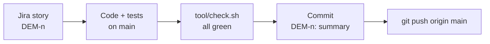

# Contributing and maintenance

Demonica is a one-person project. This page is the checklist for keeping it healthy: how changes land, what to run, and the chores that come up every few months.

## Read first

| Doc | What it answers |
| --- | --- |
| [docs/PROJECT.md](docs/PROJECT.md) | What the app is for, decisions, roadmap, fusion rules |
| [docs/ARCHITECTURE.md](docs/ARCHITECTURE.md) | Layers, folders, providers, routing, caching, performance budget |
| [docs/DESIGN_SYSTEM.md](docs/DESIGN_SYSTEM.md) | Palettes, tokens, type, components, rules for changing them |
| [docs/CODING_GUIDELINES.md](docs/CODING_GUIDELINES.md) | Where code goes, state, UI, style, tests, dependencies |
| [RUNBOOK.md](RUNBOOK.md) | Commands: run, refresh data, build, deploy |
| [CHANGELOG.md](CHANGELOG.md) | What changed in each version |

## How a change lands

1. Pick the story in Jira (project **DEM**).
2. Work on `main`. No pull requests: it is a solo project and GitHub Actions minutes are not available on the free tier.
3. Run `tool/check.sh`. It runs format, analyze (app and engine), engine tests, app tests and the release web build. **Do not push if it fails.**
4. Commit with the story key first: `DEM-12: Export saved recipes to a file`. The body lists what changed in plain words.
5. Push: `git push origin main`.
6. If the change is visible to users, add a line under **Unreleased** in `CHANGELOG.md`.

## Docs to touch with a change

| If you changed... | Update |
| --- | --- |
| A provider, a folder, a route or a storage key | docs/ARCHITECTURE.md |
| A color, font, spacing or shared widget | docs/DESIGN_SYSTEM.md |
| A fusion rule or a data fact | docs/PROJECT.md (Fusion rules / Facts) |
| A command or build step | RUNBOOK.md and `tool/check.sh` |
| Anything a user notices | CHANGELOG.md |

## Releasing a version

1. Pick the number. `0.x.0` for each roadmap phase (v0.3 Planner, v0.4 Locations), `0.x.y` for fixes.
2. Set it in **two** places: `version:` in `pubspec.yaml` (also bump the `+build` number) and `appVersion` in `lib/app/version.dart`. `test/version_test.dart` fails if they differ.
3. Move the **Unreleased** lines in `CHANGELOG.md` under the new version with today's date.
4. Run `tool/check.sh`, commit `Release 0.x.0`, tag `v0.x.0`, push with `--tags`.
5. Deploy the web build (RUNBOOK.md, "Deploy to GitHub Pages").

## Chores

| How often | Chore | How |
| --- | --- | --- |
| Every few months | Update packages | `flutter pub outdated`, `flutter pub upgrade`, then `tool/check.sh` |
| Every few months | Update Flutter | `flutter upgrade`, fix new lints, `tool/check.sh`, note the version in RUNBOOK.md |
| When upstream fixes data | Refresh game data | RUNBOOK.md, "Refresh the game data"; golden tests must pass |
| After touching `Smt4Rules` | Check speed | `cd packages/fusion_core && dart run benchmark/recipes_benchmark.dart`, compare with docs/ARCHITECTURE.md |
| When a wrong recipe is reported | Triage | Reproduce with a test in `packages/fusion_core/test`, then fix the rule or the importer |

## Reporting a wrong recipe

Settings has a "Report a wrong recipe" button that opens a GitHub issue with the data commit filled in. Please include the demon, the recipe Demonica shows, and what the game does instead.
