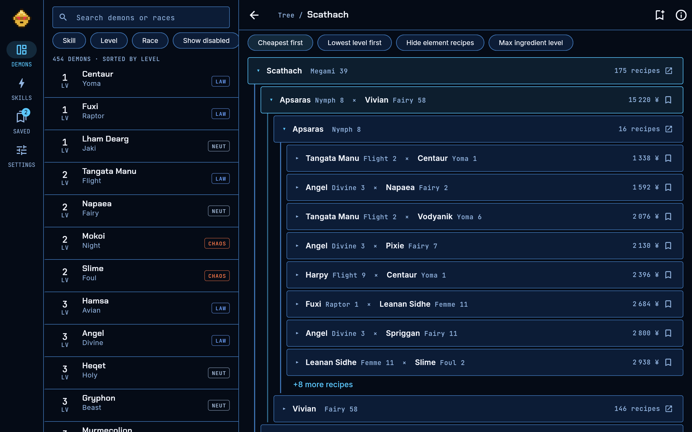
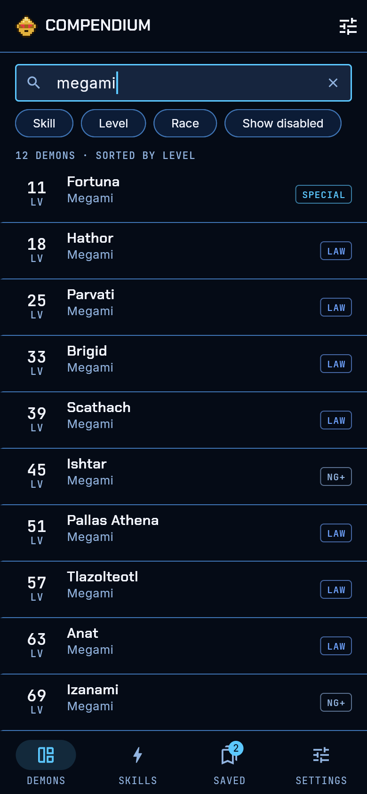
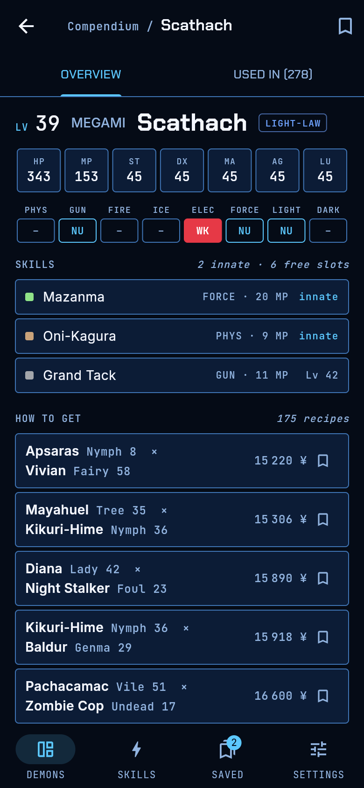
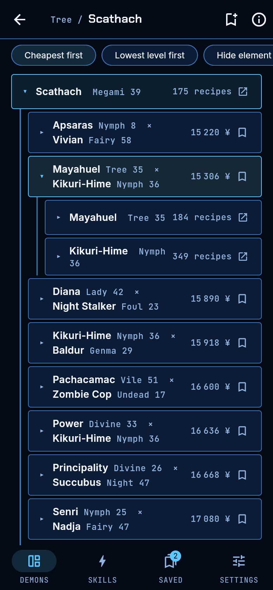
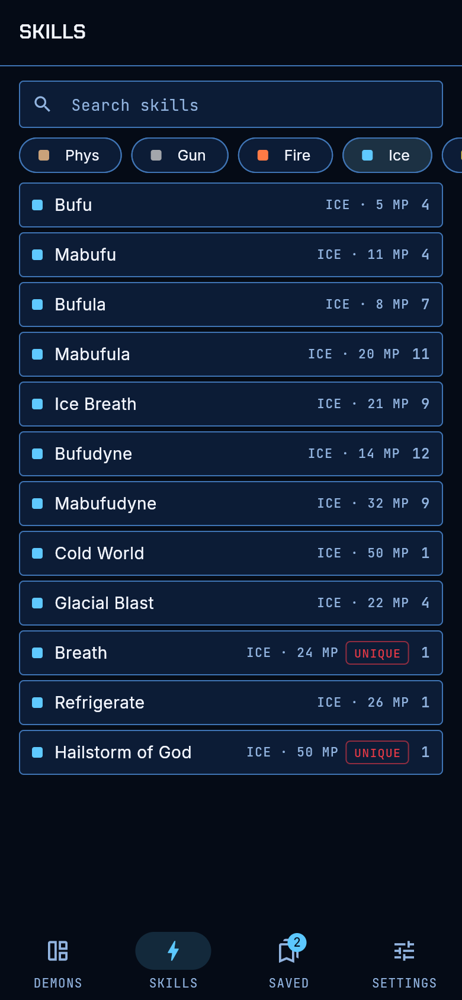
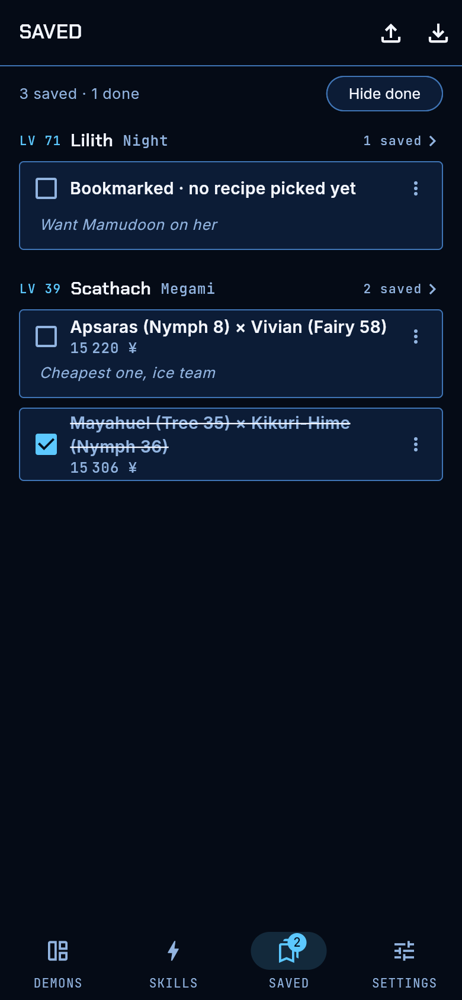
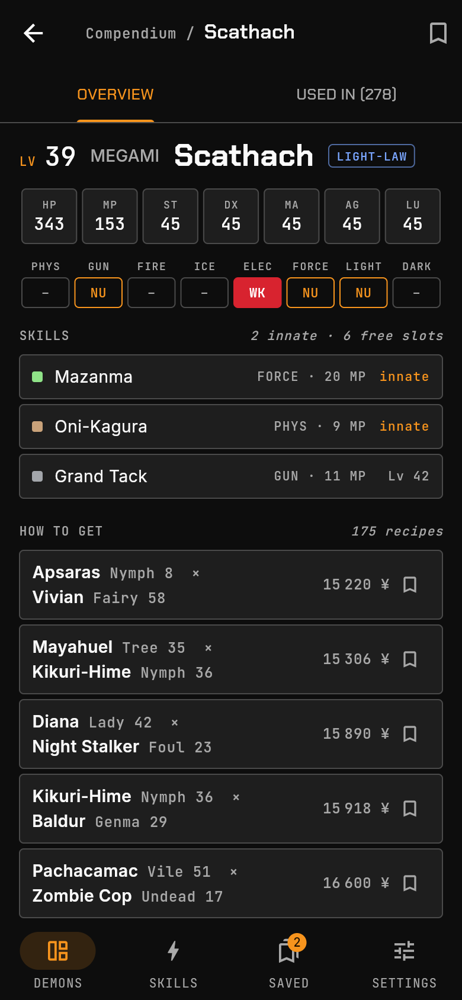
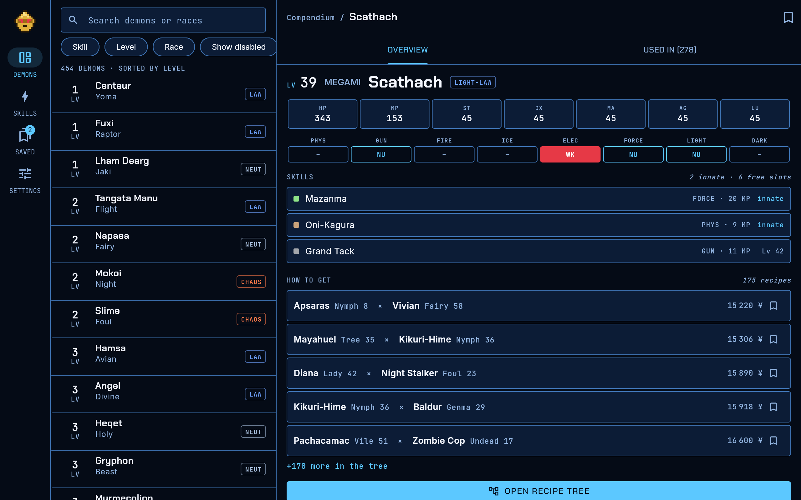

<p align="center">
  
</p>

<h1 align="center">Demonica</h1>

<p align="center">
  <strong>A friendlier fusion companion for Shin Megami Tensei IV.</strong><br>
  Pick the demon you want and see every way to fuse it, as a tree you can open one ingredient at a time.
</p>

<p align="center">
  
  
  
  <a href="https://ko-fi.com/pandaveloper"></a>
</p>

<p align="center">
  <a href="#install">Install</a> ·
  <a href="#what-it-does">What it does</a> ·
  <a href="#screenshots">Screenshots</a> ·
  <a href="#getting-started">Getting started</a> ·
  <a href="#project-layout">Project layout</a> ·
  <a href="#roadmap">Roadmap</a> ·
  <a href="#support-the-project">Support</a> ·
  <a href="#data-and-credits">Credits</a>
</p>

> Unofficial fan tool. Not affiliated with Atlus or Sega. Demon names and numbers belong to their owners, and no game art is included.

<p align="center">
  
</p>

## Why

The fusion data for SMT IV is great, but most tools show it as long tables. When you want "Scathach with Bufudyne", you end up jumping between pages and keeping the chain in your head. Demonica starts from the demon you want, shows every recipe that makes it, and lets you open any ingredient into its own recipes in the same screen, so the whole fusion path is in front of you.

## Install

| Device | How |
|---|---|
| **Any browser** | Open [ctorres345.github.io/Demonica](https://ctorres345.github.io/Demonica/). |
| **iPhone / iPad** | Open the link above in Safari, tap **Share**, then **Add to Home Screen**. It opens full screen and works offline after the first visit. |
| **Android** | Download `demonica-x.y.z.apk` from the [latest release](https://github.com/ctorres345/Demonica/releases/latest) and open it. Allow installs from your browser when asked. Or add the web app to the home screen from Chrome. |
| **Desktop** | Use the web app. In Chrome or Edge, the install icon in the address bar adds it as an app. |

## What it does

| | |
|---|---|
| **Find a demon** | Search all 454 demons. Filter by skill ("who learns Mediarahan?"), race and level. |
| **See the demon** | Stats, resistances, ailments, skills with learn level and MP cost, free skill slots, where to find it, how to get it, evolutions and re-summon price. |
| **Where to find** | Areas where the demon can be recruited, in story order, with route tags. A green speech bubble in lists and the tree marks demons you can just talk to instead of fusing. Late-game areas stay hidden until you turn spoilers on. |
| **Recipe tree** | Every normal, element and special recipe. Sort by macca or by lowest ingredient level. Tap an ingredient to open its recipes underneath. |
| **Used in** | The other direction: every fusion this demon is an ingredient for. |
| **Skills** | Pick a skill and see which demons learn it, and at what level. |
| **Plan** | Pick a target and the skills it should end with. Get numbered fusion steps: which skills to keep at each step, which ingredients to level up first, and the macca total. |
| **Saved** | Bookmark a demon, one recipe or a whole fusion path. Add a note, tick steps off as you fuse, and export or import it as a file. |
| **Your unlocks** | Turn story, quest, New Game+, Fiend and DLC demons on or off, so recipes only use what you have. |
| **Palettes** | Strange Journey (default), SMT IV and Codex looks, plus light and dark. |
| **Offline** | All game data ships inside the app. No account, no tracking. |

Demonica is a companion: it never reads your save file and does not need your level or party. Plan as far ahead as you like.

## Screenshots

<table>
  <tr>
    <td align="center"><br><sub>Search and filters</sub></td>
    <td align="center"><br><sub>Demon page</sub></td>
    <td align="center"><br><sub>Recipe tree</sub></td>
  </tr>
  <tr>
    <td align="center"><br><sub>Skill lookup</sub></td>
    <td align="center"><br><sub>Saved recipes</sub></td>
    <td align="center"><br><sub>SMT IV palette</sub></td>
  </tr>
</table>

<p align="center">
  
  <br><sub>On a wide screen, the list and the demon page sit side by side.</sub>
</p>

## Getting started

You need [Flutter](https://docs.flutter.dev/get-started/install) stable 3.47 or newer. Chrome is enough for the web version; Android Studio or Xcode for phones.

```sh
git clone https://github.com/ctorres345/Demonica.git
cd Demonica
flutter pub get
flutter run -d chrome          # web
flutter run                    # a connected phone or emulator
```

Before pushing a change, run every check with one command (there is no automatic CI, so this is the gate):

```sh
tool/check.sh
```

It runs `flutter pub get`, `dart format`, `flutter analyze`, the fusion engine tests in `packages/fusion_core`, the widget tests and a release web build, and stops at the first failure.

Building for each platform, refreshing the game data, releasing (`tool/release.sh`) and deploying to GitHub Pages are in [RUNBOOK.md](RUNBOOK.md).

## Project layout

```
packages/fusion_core/   pure Dart fusion engine: models, SMT IV rules, reverse recipes, skill planner (no Flutter)
tool/import_smt4.dart   turns the upstream data, at a pinned commit, into assets/data/smt4/
assets/data/smt4/       the game data the app ships
lib/design_system/      colour tokens, palettes, Material 3 theme, shared widgets
lib/features/           compendium, demon page, recipe tree, skills, planner, saved, settings, welcome
lib/app/                routes (go_router), state (Riverpod), adaptive phone/desktop shell
tool/check.sh           every pre-push check in one command
tool/release.sh         tag, GitHub Release with APK/IPA, web deploy (run on a Mac)
docs/                   plan, architecture, coding guidelines, design system, screenshots
```

More detail:

| Document | What it covers |
|---|---|
| [CONTRIBUTING.md](CONTRIBUTING.md) | How changes land, what to run, and the regular maintenance chores |
| [CHANGELOG.md](CHANGELOG.md) | What changed in each version |
| [docs/ARCHITECTURE.md](docs/ARCHITECTURE.md) | Layers, folders, providers, routing, caching, performance budget |
| [docs/CODING_GUIDELINES.md](docs/CODING_GUIDELINES.md) | Where code goes, state, UI, style, tests, dependencies |
| [docs/DESIGN_SYSTEM.md](docs/DESIGN_SYSTEM.md) | Colours, palettes, type and components |
| [docs/PROJECT.md](docs/PROJECT.md) | What the app is for, decisions, roadmap, fusion rules |
| [RUNBOOK.md](RUNBOOK.md) | Building, refreshing game data, releasing, deploying |

## Roadmap

- **Releases:** Android and iOS builds on GitHub.

Found a wrong recipe or a bug? Use **Report a problem** in Settings, or [open an issue](https://github.com/ctorres345/Demonica/issues/new).

## Support the project

Demonica is free and open source, and it will stay that way. If it saved you a few trips to the Cathedral of Shadows and you'd like to say thanks, you can buy me a coffee on Ko-fi. It's completely optional and very much appreciated.

<p>
  <a href="https://ko-fi.com/pandaveloper"></a>
</p>

Reporting a wrong recipe or telling a friend who is playing SMT IV helps just as much.

## Data and credits

- **Fusion data:** [aqiu384/megaten-fusion-tool](https://github.com/aqiu384/megaten-fusion-tool), released into the public domain (Unlicense). Thank you. The import script pins the upstream commit it reads from and decodes it once; the app never touches the raw files.
- **Demon locations:** collected by hand from the "Local Demon Bestiary" tables of the [GamerGuides SMT IV walkthrough](https://www.gamerguides.com/shin-megami-tensei-iv/guide/walkthrough). Facts only, no text copied.
- **Fonts:** Chakra Petch, Inter and JetBrains Mono, all under the SIL Open Font License.
