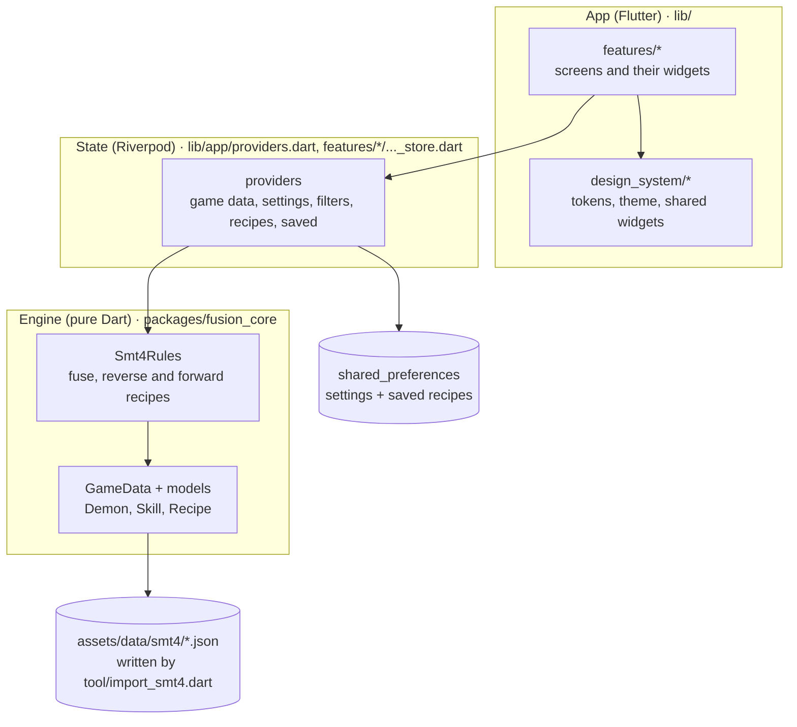
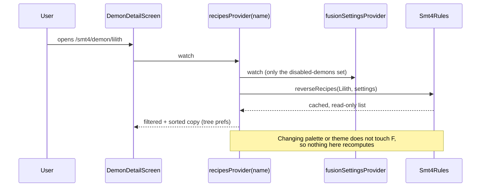

# Architecture

How Demonica is put together, where things live, and how data moves from the bundled JSON to the screen. Read this before changing anything outside one screen.

## The big picture

Three layers. Each one only talks to the layer below it.



| Layer | Folder | Knows about Flutter? | Rule |
| --- | --- | --- | --- |
| Engine | `packages/fusion_core` | No | Pure functions over `GameData`. No I/O except parsing strings it is handed. Tested with `dart test` |
| State | `lib/app/providers.dart`, `lib/features/*/*_store.dart`, `tree_state.dart` | Riverpod only | The only place that calls the engine, reads assets or writes to the device |
| UI | `lib/features/*`, `lib/design_system/*` | Yes | Reads providers, calls notifier methods. No fusion logic, no color literals |

## Folders

```
lib/
  main.dart                  entry: path URLs on web, ProviderScope
  app/
    app.dart                 router, AppShell (bottom bar or rail), two-pane compendium
    providers.dart           game data, settings, filters, recipes, used-in
    version.dart             appVersion shown in Settings
  design_system/             tokens.dart, theme.dart, components.dart, palette_card.dart, pixel_icon.dart
  features/
    compendium/              demon list, filter sheets, demon detail (Overview + Used in)
    recipes/                 recipe tree screen, RecipeRow, tree expansion state
    saved/                   saved model + file format, store, Saved screen, bookmark buttons
    skills/                  skill lookup
    settings/                palette, theme, unlock toggles, about
    onboarding/              welcome screen (first start)
packages/fusion_core/
  lib/src/model/             models.dart (Demon, Skill, Recipe, FusionSettings), game_data.dart
  lib/src/engine/            game_rules.dart (the GameRules interface)
  lib/src/games/smt4/        smt4_rules.dart
  test/                      rule tests + smt4_golden.json (independent port)
  benchmark/                 recipes_benchmark.dart
tool/
  import_smt4.dart           upstream JSON -> assets/data/smt4
  check.sh                   every pre-push check in one command
assets/data/smt4/            decoded game data (committed, do not edit by hand)
docs/                        this file, DESIGN_SYSTEM.md, CODING_GUIDELINES.md, PROJECT.md
  screenshots/               images used by the README
```

## Data flow: from a tap to a recipe list



1. `gameDataProvider` loads the six JSON files once with `rootBundle` and builds `GameData`.
2. `rulesProvider` wraps it in `Smt4Rules`.
3. `fusionSettingsProvider` exposes only the set of disabled demons from the settings. Everything that computes recipes watches this, never the whole `settingsProvider`.
4. `recipesProvider(name)` and `usedInProvider(name)` ask the engine and apply the tree preferences (sort, hide element recipes, max ingredient level).
5. Screens watch those providers and render.

## State: every provider in one table

| Provider | Kind | Holds | Persisted |
| --- | --- | --- | --- |
| `gameDataProvider` | FutureProvider | `GameData` for SMT IV | bundled asset |
| `rulesProvider` | Provider | `Smt4Rules?` (null while loading) | |
| `settingsProvider` | Notifier | palette, theme mode, onboarded, disabled demons | `demonica.settings.v1` |
| `fusionSettingsProvider` | Provider | `FusionSettings` (disabled demons only) | |
| `compendiumFilterProvider` | Notifier | search text, races, max level, skill, show disabled | no |
| `filteredDemonsProvider` | Provider | the compendium list | |
| `treePrefsProvider` | Notifier | recipe sort, hide element, max ingredient level | no |
| `recipesProvider(name)` | Provider.family | sorted reverse recipes for one demon | |
| `usedInProvider(name)` | Provider.family | forward recipes for one demon | |
| `treeExpansionProvider(root)` | Notifier.family | which tree nodes are open (one recipe per demon) | no |
| `savedProvider` | Notifier | saved demons, recipes and plans | `demonica.saved.v1` |
| `savedIdsProvider` | Provider | ids of saved entries, for bookmark icons | |
| `routerProvider` | Provider | the `GoRouter` | |

Storage keys end in `.v1`. If a stored shape ever changes in a way old code cannot read, add a `.v2` key and migrate on load; never change what `.v1` means.

## Routing

`go_router` with real paths so links work on the web and GitHub Pages:

| Path | Phone | Wide (840dp and up) |
| --- | --- | --- |
| `/welcome` | first-start screen (redirected to until onboarded) | same |
| `/smt4/demons` | compendium | list + "pick a demon" |
| `/smt4/demon/:id` | demon detail | list + detail |
| `/smt4/demon/:id/tree` | recipe tree | list + tree |
| `/smt4/skills` | skills | same |
| `/saved` | saved | same |
| `/settings` | settings | same |

`:id` is `slugify(name)`, for example `jack-frost`. The web build copies `index.html` to `404.html` so these paths load directly on GitHub Pages.

## The engine

`GameRules` (in `game_rules.dart`) is the interface each game implements: `fuse`, `reverseRecipes`, `forwardRecipes`, `canInherit`, `freeSkillSlots`. `Smt4Rules` is the only implementation today. The fusion rules in plain words are at the top of `smt4_rules.dart` and in [PROJECT.md](PROJECT.md).

Caching inside `Smt4Rules`:

- Per-race lookup tables are built once per set of disabled demons.
- `reverseRecipes` and `forwardRecipes` results are cached per demon for the same settings and returned as **unmodifiable** lists. Copy before sorting.
- Changing the disabled set clears every cache.

`GameData` precomputes `demonsByLevel` and `learnerCounts` (how many demons learn each skill) on first use.

### Adding a game (SMT IV Apocalypse, SMT V, ...)

1. Write `tool/import_<game>.dart` that writes the same six JSON files into `assets/data/<game>/`.
2. Add `packages/fusion_core/lib/src/games/<game>/<game>_rules.dart` implementing `GameRules`, plus golden tests.
3. Make `gameDataProvider` and `rulesProvider` take a game id, and add `/<game>/...` routes.
4. Screens already read through providers, so they should need no change beyond a game switcher.

## Performance budget

Measured with `dart run benchmark/recipes_benchmark.dart` in `packages/fusion_core` (cloud container, 2026-10-29):

| Work | Time |
| --- | --- |
| Parse all SMT IV data | about 60 ms |
| Reverse recipes for all 454 demons, first time | about 330 ms (about 0.7 ms per demon, 61 704 recipes) |
| Same again (cached) | under 1 ms |
| Forward recipes for all 454 demons | about 90 ms |

Rules that keep the UI fast:

- Lists use `ListView.builder` with a fixed `itemExtent` where rows have one height.
- Widgets watch the smallest slice they need (`select`, `fusionSettingsProvider`). The tree's demon nodes select only their own open state, so opening a branch rebuilds that branch.
- Anything that scans every demon (counts, indexes) is computed once in `GameData` or a provider, never inside `itemBuilder`.
- Re-run the benchmark after touching `Smt4Rules`. A big jump is a bug.

## Errors and edge cases

- Missing demon in a URL: the screen shows "No demon called ...", never throws.
- Broken saved data: the store starts empty instead of crashing (`FormatException` is caught on load). Import shows a readable message and counts skipped entries.
- File dialogs that do not exist on a platform fall back to the clipboard on export.
